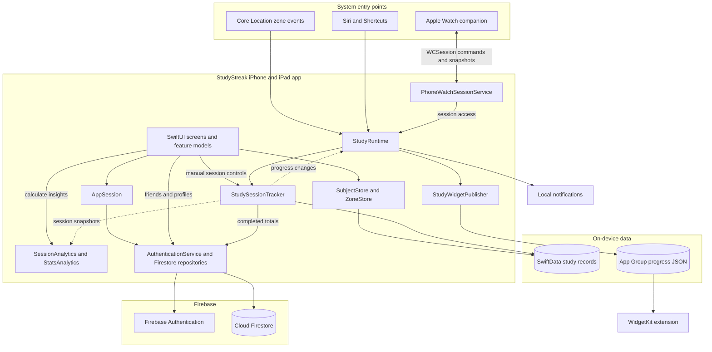

  

# StudyStreak

**A location-aware study session tracker for iPhone and iPad, with an Apple Watch companion.**

StudyStreak helps students build a consistent study routine without remembering every timer start and stop. Users can track sessions manually or let saved study zones start sessions when they arrive and pause them when they leave. Subject-based statistics, daily goals, streaks, widgets and a friend leaderboard make progress visible.

The app uses SwiftUI for its interface, SwiftData for local study records, and Firebase Authentication and Cloud Firestore for accounts and social features.

## Contents

- [Features](#features)
- [Technology](#technology)
- [Requirements and targets](#requirements-and-targets)
- [Getting started](#getting-started)
- [Using the app](#using-the-app)
- [Project structure](#project-structure)
- [Architecture](#architecture)
- [Data storage](#data-storage)
- [Session and progress rules](#session-and-progress-rules)
- [Apple platform integrations](#apple-platform-integrations)
- [Backup and restore](#backup-and-restore)
- [Design and accessibility](#design-and-accessibility)
- [Privacy and account deletion](#privacy-and-account-deletion)
- [Current scope and limitations](#current-scope-and-limitations)
- [Troubleshooting](#troubleshooting)
- [Author and design](#author-and-design)

## Features

| Area | Functionality |
| --- | --- |
| Onboarding | Three introduction screens and location/notification permission explanations. |
| Accounts | Email/password registration and sign-in, Google sign-in, password reset and unique usernames. |
| Profile | Editable display name, username and photo; initials avatar when no photo is available; all-time focus total. |
| Sessions | Start, pause, resume and finish; subject changes during a session; optional zone association; history and saved-session summary. |
| Study zones | Location search, movable map pin, adjustable radius, icons, default subject and automatic-tracking controls. |
| Subjects | Create/edit/delete, customise colours/icons, reorder by dragging and mark subjects as currently studying. |
| Home | Greeting, active session, daily progress, streak, recent sessions and weekly study bars. |
| Statistics | Day/week/month views, study-time bars, subject breakdown, zone totals and a 12-week heatmap. |
| Friends | Username search, requests, accept/decline/cancel, unfriend, username copying and text invitations. |
| Leaderboard | Live updates for this week and all time, with an opt-in visibility preference. |
| Routine | Daily goals, streak reminders and break reminders through local notifications. |
| Apple integrations | Small/medium widgets, Siri start/stop actions and manual start/stop from Apple Watch. |
| Data management | JSON export/import and permanent account deletion with reauthentication and device confirmation. |
| Appearance | Light, dark and system themes, Google Sans typography and accessibility support. |

## Technology

| Technology | Purpose |
| --- | --- |
| Swift / SwiftUI | Native interface, navigation and application logic. |
| Observation / Combine | Observable application and feature state, including the watch view model. |
| SwiftData | Persistent subjects, zones, sessions and study intervals. |
| Core Location / MapKit | Geographic-region monitoring, maps, place search and zone placement. |
| Swift Charts | Study-time charts and subject breakdowns. |
| UserNotifications | Scheduled reminders and automatic-session notification actions. |
| WidgetKit / App Groups | Home Screen widgets backed by a shared progress snapshot. |
| App Intents | Siri and Shortcuts actions for starting/resuming and stopping sessions. |
| WatchConnectivity | Commands and state updates between watch and paired iPhone. |
| PhotosUI / UIKit / ImageIO | Photo selection/capture, image processing and system sharing. |
| LocalAuthentication | Face ID, Touch ID or system-managed passcode confirmation for account deletion. |
| Firebase Authentication | Email/password and Google authentication. |
| Cloud Firestore | Profiles, username reservations, friendships, visibility and leaderboard summaries. |

Dependencies use **Swift Package Manager**. The current **Package.resolved** pins Firebase iOS SDK **12.19.2** and Google Sign-In **9.0.0**. The main app links FirebaseCore, FirebaseAuth, FirebaseFirestore and GoogleSignIn; the resolved file also contains their dependencies.

## Requirements and targets

Use a Mac with **Xcode 26.2** or a compatible newer version. The project currently uses **Swift 5 language mode**.

| Target | Purpose | Current deployment setting |
| --- | --- | --- |
| StudyStreak | iPhone/iPad app | iOS **18.6** in Debug; iOS **26.2** in Release. |
| StudyStreakWidgetExtension | Home Screen widgets | iOS **18.6**. |
| StudyStreakWatch | Apple Watch companion | watchOS **10.6**. |

The main app supports iPhone and iPad. The watch is a companion to a paired iPhone, including Apple Watch SE 1 devices running a compatible watchOS version.

The main app's Debug and Release deployment settings differ. To archive for iOS 18.6 devices, align the Release setting with that intended minimum before archiving.

A Firebase project with Email/Password and Google authentication and a Firestore database is required. Physical-device installation also requires your Apple development team and provisioning for the configured capabilities.

## Getting started

### 1. Open the project

Clone or download the repository and open **StudyStreak.xcodeproj** in Xcode. Allow Swift Package Manager to resolve dependencies.

Select **StudyStreak** for the iPhone/iPad app. Keep watch and widget source folders assigned to their own targets; adding their entire contents to the main app introduces duplicate entry points and platform-specific build errors.

### 2. Configure Firebase

1. Create or select a Firebase project.
2. Register an Apple app with the main target's bundle identifier. The checked-in identifier is **realchaula.StudyStreak**; use your own identifier for a separate project.
3. Enable **Authentication → Sign-in method → Email/Password** and **Google**.
4. Create a **Cloud Firestore** database.
5. Download **GoogleService-Info.plist** and place it at the repository root, beside **Info.plist** and **StudyStreak.xcodeproj**.
6. Include that file in the **StudyStreak** app's resources. It does not need watch or widget membership.

**StudyStreakApp.swift** loads the bundled configuration and calls FirebaseApp.configure. **GoogleService-Info.plist** is listed in **.gitignore**, so provide your own configuration for a checkout.

See the official [Firebase Apple setup guide](https://firebase.google.com/docs/ios/setup) for registration and package setup.

### 3. Configure Google sign-in and URL handling

Under **CFBundleURLTypes** in the root **Info.plist**, set a URL scheme to the **REVERSED_CLIENT_ID** from your Firebase configuration. Use the value from your own project.

Keep the existing **studystreak** scheme: widgets use **studystreak://home**. The app forwards Google callbacks to GIDSignIn through its existing onOpenURL handler.

**AuthenticationService.swift** reads Google's client ID from Firebase configuration. Both an enabled Google provider and matching reversed client-ID scheme are required. See [Firebase's Google sign-in instructions](https://firebase.google.com/docs/auth/ios/google-signin).

### 4. Deploy Firestore configuration

Backend configuration is included in:

    firebase.json
    Firebase/firestore.rules
    Firebase/firestore.indexes.json

With the Firebase CLI installed and access to your project, run from the repository root:

    firebase login
    firebase deploy --only firestore --project YOUR_FIREBASE_PROJECT_ID

Replace **YOUR_FIREBASE_PROJECT_ID** with your project ID. This deploys the supplied rules and index configuration, including exclusions for Base64 photo fields.

The app relies on these rules for username claims, private/public profile separation, friendship transitions, leaderboard visibility and account cleanup. See the [Firebase CLI documentation](https://firebase.google.com/docs/cli).

### 5. Configure signing and App Groups

Choose your development team for all three targets. If bundle identifiers change, update **WKCompanionAppBundleIdentifier** in **StudyStreakWatch/Info.plist** to match the main app.

The current shared App Group is **group.realchaula.StudyStreak**. Use a group available to your team and keep it consistent in:

- **StudyStreak.entitlements**
- **StudyStreakWidget/StudyStreakWidget.entitlements**
- **StudyStreakAppGroup** in the root **Info.plist**
- **StudyStreakAppGroup** in **StudyStreakWidget/Info.plist**

In **Signing & Capabilities → App Groups**, select the same group for the main app and widget. Each target's **Code Signing Entitlements** setting should point to its corresponding file.

The watch uses WatchConnectivity and its companion-app association rather than the widget's shared storage.

### 6. Confirm fonts and resources

The iOS fonts live in **StudyStreak/Resources/Fonts/**:

    GoogleSans-Regular.ttf
    GoogleSans-SemiBold.ttf
    GoogleSans-Bold.ttf

The root **Info.plist** registers them under **UIAppFonts**. The watch registers its regular and semibold fonts in its own **Info.plist**. Retain the existing font/resource references.

Colours, illustrations and icons live in each target's **Assets.xcassets**. **AppColors.swift** and **AppTypography.swift** centralise the main app's design tokens.

### 7. Run the app

Choose a compatible iPhone/iPad destination and run **StudyStreak**. Complete onboarding, sign in, choose a username and finish profile setup.

For the watch, install and open the updated iPhone app first, sign in and create an active subject. Then run **StudyStreakWatch** on the paired watch. Keep both apps open for the initial connection.

## Using the app

The five main tabs are **Home**, **Zones**, **Stats**, **Friends** and **Profile**.

### Start a study routine

1. Open **Profile → Your Study World → Subjects** and add a subject.
2. Choose its colour and icon and leave **Currently studying** enabled.
3. Open **Home → Start a Session**, select a subject and optionally a zone.
4. Use Pause/Resume as needed, then Stop to finish and save.
5. View the result on Home, in session history and in Stats.

### Enable automatic sessions

1. Add a zone from the **Zones** tab.
2. Search for a place or position the pin, then choose a name, icon and radius between **100 and 500 metres**.
3. Select an active default subject and save the zone.
4. Allow **Always** location access, **Precise Location** and **Background App Refresh**. Enable automatic tracking and the individual zone.
5. An entry event starts a session using that subject; an exit event pauses it. A banner or notification lets you confirm or change the subject.

The zones screen reports unavailable permissions, paused tracking and monitoring-capacity conditions. Manual sessions remain available when automatic tracking is unavailable.

### Add friends

Open **Friends → Add friend** and search by username. Incoming requests can be accepted or declined; outgoing requests can be cancelled. Accepted friends can be removed with Unfriend.

Copy copies the username alone. Share opens the system share interface with a text invitation containing the username. Turn on **Leaderboard visibility** in Profile to share totals with accepted friends.

### Manage preferences

Profile groups its controls in this order:

1. **Your Study World** — zones, subjects and leaderboard visibility.
2. **Your Routine** — daily goal and notification preferences.
3. **Preferences** — appearance and profile editing.
4. **Your Data** — export and import backup.

Sign-out and account-deletion actions follow these groups. Daily goals range from **15 to 240 minutes**, in 15-minute steps. The default is **120 minutes**; changes take effect the following day.

## Project structure

Overview of the main source and configuration folders:

    StudyStreak/
    ├── StudyStreak.xcodeproj/
    ├── Info.plist                       # iOS permissions, fonts and URL schemes
    ├── GoogleService-Info.plist          # Local Firebase configuration
    ├── StudyStreak.entitlements
    ├── firebase.json
    ├── Firebase/
    │   ├── firestore.rules
    │   └── firestore.indexes.json
    ├── StudyStreak/                     # Main iOS application
    │   ├── StudyStreakApp.swift
    │   ├── ContentView.swift
    │   ├── App/                        # Account state, runtime and navigation
    │   ├── Core/
    │   │   ├── Firebase/               # Auth and Firestore repositories
    │   │   ├── Images/                 # Profile image processing
    │   │   ├── Location/               # Permissions, geofences and rules
    │   │   ├── Models/                 # SwiftData models and value snapshots
    │   │   ├── Notifications/          # Automatic-session and routine alerts
    │   │   ├── Persistence/            # Store, backups and local cleanup
    │   │   ├── Security/               # Device confirmation for deletion
    │   │   ├── Shortcuts/              # App Intents and subject entities
    │   │   ├── Watch/                  # iPhone side of WatchConnectivity
    │   │   └── Widgets/                # Progress snapshot publisher
    │   ├── DesignSystem/               # Colours, typography and shared UI
    │   ├── Features/
    │   │   ├── AccountSetup/
    │   │   ├── Authentication/
    │   │   ├── Friends/
    │   │   ├── Home/
    │   │   ├── Onboarding/
    │   │   ├── Permissions/
    │   │   ├── Profile/
    │   │   ├── Sessions/
    │   │   ├── Stats/
    │   │   ├── Subjects/
    │   │   └── Zones/
    │   ├── Resources/Fonts/
    │   └── Assets.xcassets/
    ├── Shared/
    │   ├── StudyProgress.swift         # Time totals and streak calculations
    │   ├── WidgetProgress.swift        # Widget snapshot and projection
    │   └── WatchSessionMessage.swift  # Codable watch requests and replies
    ├── StudyStreakWidget/              # Widget provider, view and resources
    └── StudyStreakWatch/               # Watch UI, view model and connectivity

## Architecture

The project uses a feature-based SwiftUI structure. Views present state and user actions; observable models, store helpers and services manage the underlying work. Features such as Friends, backups and the watch use view models. The phone's runtime coordinates platform integrations around one session tracker.

Solid arrows show calls or storage access; dashed arrows show session snapshots and progress updates. The watch controls the paired iPhone's session engine. The widget reads shared progress JSON rather than opening the SwiftData database.

| Component | Responsibility |
| --- | --- |
| StudyStreakApp | Configures Firebase, creates local persistence/account state and connects lifecycle events. |
| ContentView | Chooses onboarding, permissions, authentication, setup, recovery or the main interface. |
| AppSession | Tracks authentication/profile state, setup, sign-out and deletion. |
| MainTabView | Owns tab destinations and Home navigation requests. |
| StudyRuntime | Connects account changes, zone events, notifications, shortcuts, widgets and watch commands. |
| StudySessionTracker | Saves session transitions and exposes current/history snapshots, progress and leaderboard updates. |
| SubjectStore / ZoneStore | Validate and save the signed-in account's subject and zone changes. |
| SessionAnalytics / StudyProgress | Merge time ranges, split daily totals and calculate goals/streaks. |
| StatsAnalytics | Builds chart, subject, zone and calendar data from immutable snapshots. |
| Firebase repositories | Encapsulate authentication and Firestore queries, transactions and listeners. |
| WatchSessionViewModel | Drives watch screens and sends commands to the paired iPhone. |

Manual controls, zone events, Siri and the watch all reach the same iPhone session engine. Main-actor coordination keeps UI-related state changes together. Immutable snapshots such as **SessionRecord** let analytics and integrations work with plain values rather than sharing live SwiftData objects.

## Data storage

### Local study records: SwiftData

**LocalPersistence.swift** creates the named **StudyStreakLocal** store with CloudKit disabled. Subjects, zones and sessions include an **ownerID**, so queries and writes can stay scoped to the signed-in Firebase user.

| Model | Important data and relationships |
| --- | --- |
| StudySubject | UUID, owner, name, colour/icon IDs, order, active status and timestamps. Can be the default subject for several zones. |
| StudyZone | UUID, owner, name/address, coordinates, radius, icon, enabled state, timestamps and an optional default-subject relationship. |
| StudySession | UUID, owner, start/end, state, manual/automatic source, pause/confirmation state, subject snapshot and optional zone ID/name. Owns study intervals. |
| StudyInterval | Start/end and subject snapshot for an uninterrupted study block. Belongs to a session and is removed with it. |

Session and interval snapshots retain their labels even if the corresponding subject is later changed or deleted. Full histories and saved zone coordinates are kept in the local store.

### Preferences and shared widget data

UserDefaults stores account-specific daily-goal history, notification preferences and automatic-zone preferences. Appearance is a device preference. Onboarding/permission-flow completion is also stored locally.

Widgets read a Codable JSON snapshot from the App Group container. It contains time ranges, goal history and running-session timing, without zone coordinates, profile photos or Firebase credentials.

### Cloud data: Firestore

    users/{uid}
    usernames/{canonicalUsername}
    friendProfiles/{uid}
    friendships/{senderUID}:{recipientUID}
    leaderboardPreferences/{uid}
    leaderboardStats/{uid}

| Collection | Purpose |
| --- | --- |
| users | Owner-readable profile, display name, optional Base64 photo and setup status. |
| usernames | Unique username-to-UID reservations. Transactions prevent two accounts claiming the same name. |
| friendProfiles | Searchable identity mirror with username, display name and optional photo, separate from private profile documents. |
| friendships | Sender, recipient, member IDs, pending/accepted status and timestamps. Transactions check requests in both directions. |
| leaderboardPreferences | Whether the account has opted into sharing totals with accepted friends. |
| leaderboardStats | Completed-study aggregate: UTC week ID, weekly/all-time seconds, streak, streak day and time-zone ID. |

Firestore listeners update friendship and leaderboard screens as data changes. Profile/username changes use transactions. The supplied rules restrict private profiles to their owners and friend totals to accepted friends with visibility enabled.

Usernames use 3–20 lowercase letters, digits, periods or underscores. Display names can contain up to 50 characters; an empty display name falls back to the username.

### Offline behaviour

After account setup and access to the app, local subject/zone/session work and analytics can operate offline. Sign-in, username checks, friend search/actions and transaction-backed cloud changes require connectivity. Leaderboard upload failures leave sessions local and allow later retries.

The app is designed around one primary iOS installation per account. JSON backup/restore provides a manual way to move local study records.

## Session and progress rules

- **One unfinished session:** another start is rejected until the running or paused session is finished.
- **Timestamp-based duration:** elapsed time comes from saved timestamps; a foreground display timer is not the stored source of truth.
- **Pause gaps:** pausing closes an interval; resuming creates another, excluding the gap.
- **Subject attribution:** changing subjects while running closes the previous interval and opens one for the new subject.
- **Daily boundaries:** time is split between calendar days for totals and streaks.
- **Overlaps:** intervals are merged for overall totals. Statistics attribute overlap consistently so subject/zone breakdowns match the total.
- **Streak:** a day qualifies when it reaches the goal that applied on that day. An unfinished current day preserves yesterday's streak until the current day is missed.
- **Goal history:** effective dates prevent a new goal from rewriting earlier streak days.
- **Leaderboard:** only completed sessions contribute to public aggregates; Home can include current-session progress.
- **Weekly rankings:** friends share a Monday-to-Monday UTC week. Daily goals and personal statistics use the device's local calendar/time zone.

For automatic sessions, entry can start a session and exit pauses it. A manual session or deliberate user pause takes priority over location events. Manual Stop suppresses affected zones until an exit is observed, preventing an immediate restart while still there. **ZoneAutomationPolicy** handles overlap and resume decisions.

## Apple platform integrations

### Location and maps

**StudyZoneMonitoringService** registers CLCircularRegion instances with CLLocationManager. MapKit supplies maps and place search; the app reacts to system-delivered region events.

Automatic tracking requires an enabled zone, active default subject, Always authorisation, Precise Location, Background App Refresh and monitoring availability. The implementation respects the available portion of iOS's **20-region limit** and exposes capacity/error state.

Geofence events follow iOS location/background policies; delivery is not guaranteed to occur exactly on the drawn circle or immediately after crossing it. See Apple's [geographic region monitoring documentation](https://developer.apple.com/documentation/corelocation/monitoring-the-user-s-proximity-to-geographic-regions).

### Local notifications

Notifications provide:

- Streak/daily-goal encouragement at the selected time when the goal is not reached.
- Break reminders during uninterrupted focus.
- Automatic-session subject confirmation, with “That's right” and a saved-subject text-entry action.

Plans are rebuilt as progress/settings change. A real pause resets the focus block; changing subjects alone does not. Break intervals support **25, 30, 45, 60, 90 or 120 minutes**. Defaults are **20:00** for streak reminders and **60 minutes** for breaks.

### Home Screen widgets

**StudyStreakWidget** supports small and medium families showing a streak, today's minutes and, in the medium layout, a seven-day chart. **StudyWidgetPublisher** writes progress; **StudyProgressProvider** reads it to create a timeline.

The extension does not open SwiftData or authenticate with Firebase. App actions request timeline reloads; WidgetKit controls actual refresh timing. Tapping a widget opens Home through **studystreak://home**.

### Siri and Shortcuts

| App Intent | Behaviour | Example phrase |
| --- | --- | --- |
| Start Study Session | Starts an active subject, asks which one when needed, or resumes an eligible paused session. Repeating Start keeps the existing running session. | “Hey Siri, start my study session in StudyStreak.” |
| Stop Study Session | Finishes and saves the current running or paused session. | “Hey Siri, stop the study session in StudyStreak.” |

Both open the app and use the authenticated account. Add at least one active subject before starting. Resuming an automatic session also respects zone-presence rules. The actions are available in the Shortcuts app.

### Apple Watch companion

The watch provides subject selection, an active timer, stop confirmation, a saved state and connection/setup feedback. Its scope is manual **start and stop**; the paired iPhone saves the session.

**WatchConnectionService** sends Codable requests over WCSession. **PhoneWatchSessionService** checks account/session identity and calls the existing tracker. Updated snapshots keep an open watch view informed.

There is no separate watch Firebase login or session database. Commands require a reachable paired iPhone and are not queued for later execution. A lost connection produces retry/status feedback instead of assuming a save succeeded. Resume a paused session on the phone.

## Backup and restore

Open **Profile → Your Data**.

**Export backup** creates **StudyStreak-Backup.json** and opens the system share sheet. The file uses format version **1** and timestamps encoded as milliseconds since the Unix epoch. It contains:

- Owning Firebase UID and export timestamp.
- Subjects, IDs, appearance, ordering, active state and timestamps.
- Zones, coordinates, radius and default-subject references.
- Completed sessions and intervals, including historical subject/zone labels.
- Daily-goal history.

**Import backup** opens Files, validates the JSON and presents its date and record counts. **Replace data** replaces this account's local study records; Cancel leaves them as they were.

Import requires the same Firebase account, a supported format version and no running/paused session. The reader limits files to **25 MB** and rejects invalid dates, duplicate IDs, broken zone references and invalid intervals/goals. Reusing IDs prevents duplicates when restoring repeatedly.

SwiftData replacement uses one save with rollback on failure. Daily-goal preferences are written afterward to UserDefaults, a separate store. The runtime refreshes session snapshots, zone monitoring, reminders, widgets and watch state. Restored history can explicitly replace leaderboard totals, including lower totals from an older backup.

Backups are ordinary JSON and include saved zone coordinates. Credentials, profile photos, friendships and device permissions are not included; cloud profiles/social data remain with the Firebase account.

## Design and accessibility

StudyStreak uses a calm blue-and-amber identity, light/dark colour assets and Google Sans. Shared components provide consistent rounded cards and spacing; native navigation, sheets, maps and sharing handle platform interactions.

Accessibility support includes VoiceOver labels, values and hints; heading/selected traits; grouped summaries for timers, charts and leaderboard rows; hidden decorative imagery; Dynamic Type font scaling/larger-text layouts; and reduced animations with Reduce Motion. Copying a username posts a spoken confirmation.

## Privacy and account deletion

- Firebase Authentication manages passwords and sign-in credentials.
- Saved zone coordinates and detailed histories remain local unless the user exports a backup.
- Friends search uses a searchable identity mirror rather than private profile access.
- Leaderboard sharing requires opt-in and accepted-friend access under Firestore rules.
- Photos are cropped/compressed to JPEG with a **150 KB** image limit before Base64 encoding. Re-encoding omits source GPS/EXIF metadata. Without a photo, the avatar shows the first letter of the username.

**Delete Account** requires provider reauthentication and device-owner confirmation through LocalAuthentication. Face ID or Touch ID is offered when available, with system-managed passcode fallback. The flow stops automation, removes cloud profile/username/social/leaderboard data, clears local account data, then deletes the Firebase Auth user last so cleanup retains permission. An interrupted deletion has a recovery state.

## Current scope and limitations

- Full study records use local SwiftData; subjects, zones and session history do not automatically sync to the cloud.
- The watch depends on its paired iPhone and does not record independent offline sessions.
- Background location delivery, notification presentation and widget scheduling are controlled by the operating system.
- Email/password and Google sign-in are available, but an explicit provider-linking flow is not yet implemented. Existing users should retain their original sign-in method.
- Leaderboard summaries are calculated on the client and uploaded; there is no separate server-side session-verification service.
- The main app's Release deployment minimum is currently higher than Debug.

## Troubleshooting

| Symptom | Where to look |
| --- | --- |
| Firebase startup cannot complete | Confirm the correct GoogleService-Info.plist is bundled in the main app and its bundle ID matches Firebase registration. |
| Google sign-in reports missing configuration | Enable Google in Firebase Auth and use its matching REVERSED_CLIENT_ID scheme in the root Info.plist. |
| Username, friendship or profile operations are denied | Confirm authentication and deploy the current rules to the Firebase project used by the app. |
| Widget shows a generic prompt or no progress | Open/sign into the main app, then confirm App Group IDs, both entitlements files, Info keys and signing are consistent. |
| Widget build reports duplicate @main | Keep the active StudyStreakWidget.swift entry point. The existing StudyStreakWidgetBundle.swift template is excluded from the extension's source membership. |
| Watch says iPhone unavailable | Open the updated phone app, complete setup, keep paired devices connected and retry. Confirm the companion bundle ID. |
| Watch will not install | Confirm its OS meets the target's 10.6 minimum and the correct signing team/paired device is selected. |
| Automatic sessions do not start | Review Always/Precise location, Background App Refresh, active default subject, zone/automatic switches and the Zones status message. |
| Custom font is missing | Confirm font resources are bundled and UIAppFonts names match. |
| Import is rejected | Finish the current session, sign into the backup's owning account and choose supported JSON within the size limit. |
| An iOS 18.6 device cannot run an archive | Review the main app's Release deployment target, currently iOS 26.2. |

## Author and design

**DEVINDA** — StudyStreak, iOS Application Development project.

- [Figma design file](https://www.figma.com/design/T8Rjttl5lYE4b2G2RAD7uv/StudyStreak?node-id=2-74)
- [Interactive iOS prototype](https://www.figma.com/proto/T8Rjttl5lYE4b2G2RAD7uv/StudyStreak?page-id=2%3A74&node-id=3-2&starting-point-node-id=3%3A2&scaling=scale-down)
- [Apple Watch designs](https://www.figma.com/design/T8Rjttl5lYE4b2G2RAD7uv/StudyStreak?node-id=351-69)

